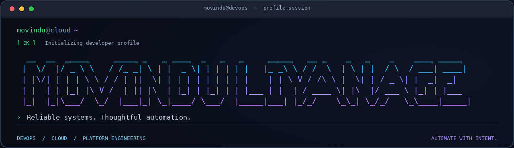

<p align="center">
  
</p>

---
### `$ whoami`

Software Engineering graduate, DevOps practitioner, and open-source contributor.

I work with **Terraform, Kubernetes, and CI/CD pipelines** to automate deployments and improve system reliability. I’m interested in the systems behind great developer experiences—from internal developer platforms to cloud and AI infrastructure.

### `$ ./connect.sh`

[🌐 Portfolio](https://movin.dev) &nbsp; · &nbsp;
[💼 LinkedIn](https://linkedin.com/in/movindu-liyanage) &nbsp; · &nbsp;
[📧 Email](mailto:movinduliyanage@gmail.com)

### `$ cat background.yaml`

```yaml
education:
  degree: BSc in Software Engineering
  university: SLIIT
  honours: Second Class Upper Division

experience:
  role: Intern DevOps Engineer
  company: Sysco LABS
  focus: Internal Developer Platform

leadership:
  - Dev Lead @ SLIIT SESC
  - Event Coordinator @ SLIIT FOSS

interests:
  - DevOps & Site Reliability Engineering
  - Internal Developer Platforms
  - Cloud & AI Infrastructure
  - Open Source
```
<p align="center">
  
</p>
---

```text
[ status: active]
Open to collaborations and opportunities in DevOps & Cloud Engineering.
```

